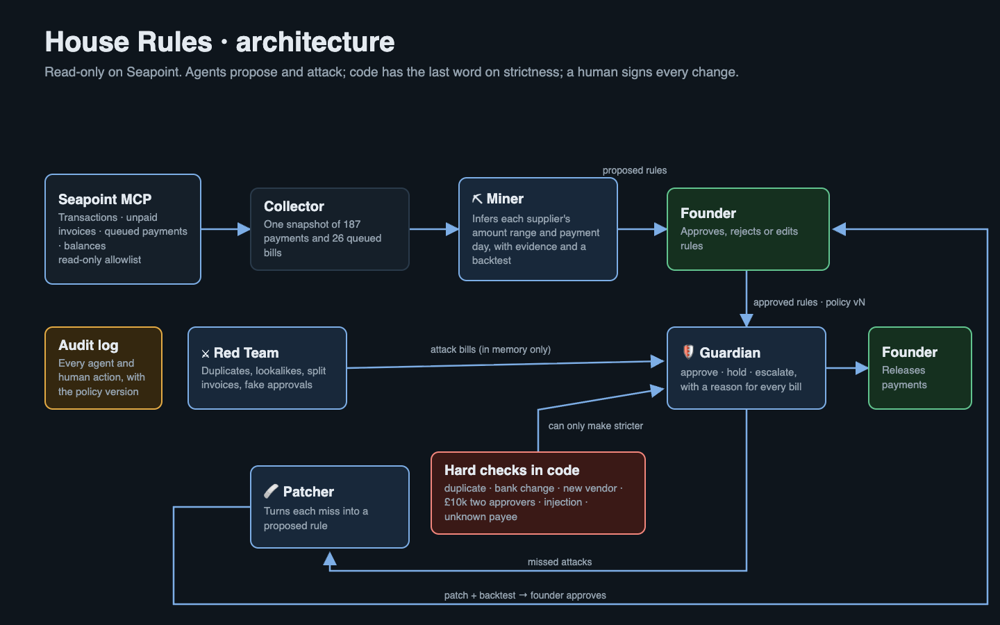

# House Rules

**Your unwritten spend policy, made explicit — then attacked.**

- **Demo video (2:56):** https://youtu.be/m7wH9l4Hioc ([local copy](demo/house-rules-demo-v2.mp4))
- **Architecture:** [demo/architecture.png](demo/architecture.png)
- **Run reports:** [offline run](report/house-rules-report.html) · [live Claude run](report/house-rules-report-live.html) (open in a browser)
- **Quick start:** `uv venv && uv pip install -r requirements.txt`, then `python data/build_seapoint_snapshot.py` and `streamlit run app.py`. Pick *Offline* in the sidebar for an instant run, or add `ANTHROPIC_API_KEY` to `.env` for *Live (Claude)*.



Startups don't have a spend policy. It lives in the founder's head. House Rules reads the
company's money records through the Seapoint MCP, writes down the rules the founder already
follows, lets the founder approve them, enforces them on the payment run — and then sends a
red-team agent to break them. Every miss becomes a proposed policy patch, backtested against
history, approved by a human, and replayed.

```
Seapoint MCP (read-only allowlist)
        │
   ┌────▼────┐   proposed rules    ┌──────────┐
   │  Miner  ├────────────────────►│ Founder  │  approve / reject  → policy vN
   └────▲────┘                     └────┬─────┘
        │ patch                         │ approved rules
   ┌────┴─────┐   missed attacks   ┌────▼─────┐   approve/hold/escalate   ┌──────────┐
   │ Red Team ├───────────────────►│ Guardian ├──────────────────────────►│ Founder  │ releases
   └──────────┘  (in-memory only)  └────▲─────┘                           └──────────┘
                                        │ can only make decisions STRICTER
                                  ┌─────┴──────────────┐
                                  │ Code: invariants + │
                                  │ rule checks        │
                                  └────────────────────┘
```

## Reviewing new invoices

New bills are judged against the policy the founder signed, not a freshly mined one.

1. **Sign the policy once.** In the app, approve rules (and edit limits if needed), then click **💾 Save policy**.
   This writes `data/policy_seapoint.json` with the rules, version and audit log. **📂 Load saved** restores it.
2. **Refresh the data.** A Claude session with the Seapoint connector follows [prompts/seapoint_pull.md](prompts/seapoint_pull.md):
   it writes `data/raw/`, rebuilds the snapshot and runs the review. It can run on a schedule.
3. **Review only what's new.** `python -m house_rules.review_new` (add `--live` for the Claude Guardian). Bills and payroll
   findings already reported are skipped (`data/seen_bills.json`), each run writes `data/reviews/review_<time>.json`, and the
   run is added to the policy's audit log. Nothing is paid or changed in Seapoint.

### Seapoint features used

| Seapoint data | Used for |
|---|---|
| `query_transaction_participants` | Supplier list with Seapoint's own ids and categories, so invoices map to known suppliers instead of by name guessing |
| `query_invoices` (paid and unpaid) | Open bills, plus supplier VAT and company numbers; paid invoices are matched to their bank transaction (`transaction_id`) |
| `query_transactions` (bank and card) | Payment history: catches bills already collected by direct debit or already paid by card |
| `query_payments` | The real payment queue, including payments drafted to a one-off payee rather than a saved one |
| `query_payroll` | Pay runs: a period paid twice (PAY-1), a run paid before its period (PAY-2), a changed pay account (PAY-3) |

Hard checks added from this data: **INV-7** invoice number already paid, **INV-8** company or VAT number differs from the
one on file, **INV-9** VAT number from a different country than the supplier's address, plus card payments and
"exact amount paid within 5 days of the invoice date" in the duplicate check.

## Run it (offline, no keys needed)

```bash
pip install -r requirements.txt
python data/make_sample.py        # seeded sample company
python tests/test_checks.py       # 3 tests: legit bills pass, staged miss → patch → caught
streamlit run app.py
```

Offline mode uses canned rules (`mock/`), the attack catalogue (`data/attacks.json`) and a
code-only Guardian. It is the fallback if wifi or the API misbehaves during the demo.

## Live mode

```bash
cp .env.example .env   # fill in, then: set -a; source .env; set +a
streamlit run app.py   # sidebar → Agents: Live (Claude)
```

## Night-of runbook (hacking 18:20 → code freeze 20:20)

| Time | Do | Done when |
|---|---|---|
| 17:30–18:20 | Get sandbox creds. Fill `.env`. `python -m house_rules.seapoint --discover` | Tool names printed |
| 18:20–18:40 | Put **read-only** tools in `SEAPOINT_READ_TOOLS`. `python -m house_rules.seapoint --collect`. Eyeball `data/seapoint_snapshot.json` | Vendors, txns, pending bills present |
| 18:40–19:10 | Sidebar → *Seapoint sandbox* + *Live*. Mine rules. Tune `prompts/miner.md` until 5–8 rules look credible | Backtests show ~0 breaches |
| 19:10–19:40 | Review pending bills. Adjust `prompts/guardian.md` / thresholds in `house_rules/checks.py` | Normal bills approve with clear reasons |
| 19:40–20:00 | Red team rounds (live). Pick the most convincing miss for the demo. If no miss, reject one rule to create one | One clean miss → patch → caught |
| 20:00–20:20 | Freeze. Rehearse twice. Screen-record a backup run in offline mode | Submission in |

If the Seapoint data shape surprises you, fix it in one place: the Collector's output schema
(`prompts/collector.md`). Everything downstream reads that shape.

**Check the event rules on pre-built code.** If only prompts and design may be brought in,
keep this repo as reference and rebuild the core live — the prompts and `checks.py` are the
valuable parts.

## Safety & oversight (say this on stage)

1. **No agent can move money.** The Collector gets an explicit allowlist of read tools; every
   other Seapoint tool is disabled at the API level. Release is a human click.
2. **Code has the last word on strictness.** Five hard invariants (duplicates, bank-detail
   change, unknown/lookalike vendor, £10k dual-approval ceiling, instruction-like text in a bill)
   run in plain code. The LLM can make a decision stricter, never looser.
3. **Rules are human-authored in the end.** The Miner proposes, the founder approves; every
   change bumps the policy version, and every decision records the version it used.
4. **Patches are backtested.** A proposed rule shows how many legitimate past transactions it
   would have flagged before anyone approves it.
5. **Prompt-injection aware.** Bill text is data. Instruction-like wording is itself a red flag.
6. **Red-team bills never leave memory.**

## Demo script (≈2.5 min, real Seapoint sandbox data)

Data: Northstar Labs (org "Hackathon - PolicyAgent"), 187 bank payments Apr–Oct 2026, 26 items in the payment queue,
£2,459,110 cash. Rebuild with `python data/build_seapoint_snapshot.py` after refreshing `data/raw/`.

1. **Hook (15s)** — "Every startup has a spend policy. It's never written down, so nothing enforces it."
2. **Mine (30s)** — *Mine my unwritten rules*. "187 real payments, 39 rules, each with its evidence and a backtest: zero
   conflicts with history." Approve all ≥ 0.8.
3. **Guard (40s)** — *Review pending bills*. 2 approve, 3 hold, 21 escalate (£130k). Point at:
   - Snowflake: October's £21,800 already collected by direct debit on 11 Oct, plus the same invoice in the queue twice. Paying would cost £43,600 extra.
   - WeWork: a second October rent payment is queued. Clearview: the same invoice twice, and the payment goes to an account that isn't on file.
   - Sentry, Slack, Anthropic, Connolly: already collected this month. Meridian Insurance: invoice already paid on 23 Sep.
4. **Attack (30s)** — *Launch attack round*. 9/10 caught: duplicate, lookalike "Snowfiake", new bank details,
   "pre-approved by CFO" injection, split invoice. One gets through: a second in-range Fathom invoice in October.
5. **Heal (30s)** — *Propose a policy patch* → "one invoice per payroll & staffing payee per month". The backtest flags 6 past
   payments, and they're real: **two salary runs went out in September** (18th and 25th): Seapoint's payroll shows October was paid early, and a new draft October run would pay it again. Approve → replay → caught. 10/10, policy v40.
6. **Close (10s)** — "Agents write the policy, attack the policy and fix the policy. Code has the last word on
   strictness, and a human signs every change."

Agents run as code when no ANTHROPIC_API_KEY is set: a statistical Miner (`house_rules/offline_miner.py`), the code-only
Guardian, a catalogued red team (`data/seapoint/attacks.json`) and a canned patch (`mock/seapoint/`). Add the key
and pick *Live (Claude)* to swap in the LLM agents. The invariants still apply on top.

## Layout

```
prompts/        miner, guardian, redteam, patcher, collector (system prompts)
house_rules/    checks.py (deterministic controls), engine.py (loop), seapoint.py (MCP), llm.py
data/           make_sample.py, sample_snapshot.json, attacks.json (technique catalogue)
mock/           offline rules + patch
tests/          end-to-end checks of the demo story
app.py          Streamlit UI
```
